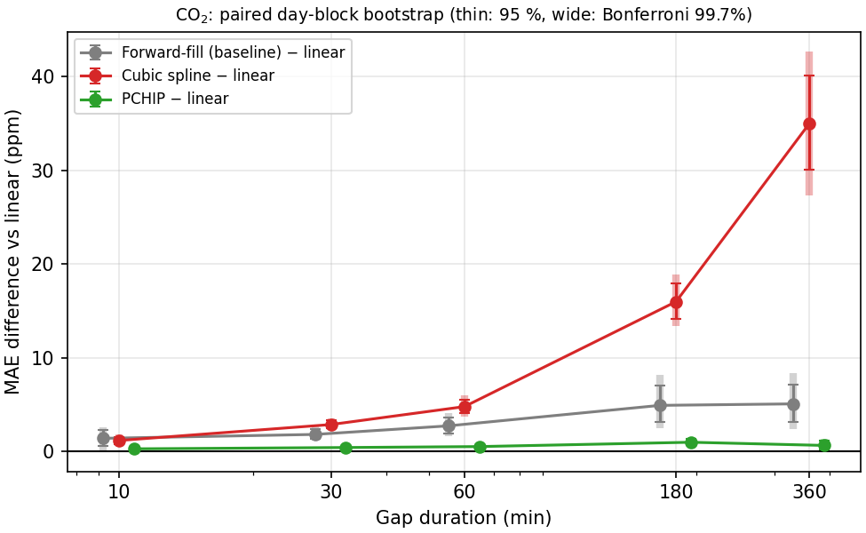

# Reconstructing Missing Indoor CO₂ Readings from a Building Sensor Log

*MMA3001 Numerical Methods and Machine Learning, individual project report. DRAFT for the author to review, edit and take ownership of.*

> **Note to author.** All numbers in this draft come from files produced by the code in this repository (`results/*.csv`, `results/*_run_info.json`, `data/processed/extraction_summary_6012002000869.json`). If you re-run anything, re-check the numbers. Sections marked **[AUTHOR]** need your own input.

---

## 1. Engineering problem

**Context.** Commercial buildings monitor indoor CO₂ because it is a practical proxy for how well a space is ventilated relative to the number of people in it. Building management (BMS) and HVAC analyses, such as ventilation audits, demand-controlled-ventilation tuning and comfort and energy reports, work on logged time series. Wireless sensor logs contain dropouts. Analyses then either discard incomplete periods or fill them, and filling them badly can bias averages, peak estimates and threshold-exceedance counts.

**Problem addressed.** Given a log of genuine CO₂ readings with a missing block, estimate the missing readings and quantify how the error of simple reconstruction methods grows with the length of the gap.

**Research question.** *How does the accuracy of reconstructing missing indoor CO₂ measurements degrade as gap duration increases, and how do linear interpolation and cubic-spline interpolation compare with a simple forward-fill baseline?*

**Intended use.** Retrospective gap filling of archived logs before analysis, with an evidence-based limit on how long a gap can be filled before the result should be flagged or discarded. Linear and spline interpolation use the reading *after* a gap, so they are not real-time methods. Only forward-fill could run in real time.

**Scope and why it was narrowed.** Dataset 2 was first considered for occupancy prediction. The data audit (Section 2.3) found no environmental sensor that is confirmed to share a room with an occupancy floor space. The workbook's own occupancy sheet is labelled "Incorrect Data". An occupancy-prediction project would therefore rest on an unverifiable pairing. The project was narrowed to gap reconstruction for the one sensor with long, clean, located live data. Limitations of this scope are discussed in Section 6.

## 2. Inputs, outputs and data

### 2.1 Top-level inputs

| Input | Format | Units / domain | Handling of invalid input |
|---|---|---|---|
| Raw environmental CSV (`5EnvSensor_MayToDec2024_180kRows.csv`, 353 MB) | CSV with columns `id, sensorid, devicetype, jsondata, status, processing_errors, createdate, processdate` | `jsondata` is a JSON list of `{values:[{time, value}], variable:{name, unit}}` | Missing file → `FileNotFoundError`; missing column → `ValueError` |
| Sensor ID | string, exact match | `6012002000869` | No matching rows → the run stops with a message |
| CO₂ value | JSON number | ppm; accepted range 250–5000 ppm | Rejected and counted by reason: bad JSON, variable absent, wrong unit, empty values, `errorCode`, missing/non-numeric/NaN value, bad timestamp, out of range |
| Measurement time | JSON `time` | Unix seconds (UTC) | Non-numeric or ≤ 0 → rejected. Duplicates: identical value → stale repeat (dropped); different value → conflict (first kept, counted) |
| Experiment settings | constants in `experiment.py` | gap durations 10/30/60/180/360 min; test fraction 0.3; context candidates 2–32; ≤200 gaps; seed 2024 | — |

The JSON `time` is used rather than `createdate`. `createdate` is the server's storage time, it mixes +10 and +11 UTC offsets (daylight saving), and it keeps advancing while the sensor is silent.

### 2.2 Outputs

| Output | Meaning and use |
|---|---|
| `data/processed/co2_6012002000869.csv` (`epoch_s, time_utc, co2_ppm`) | Cleaned series of genuine readings: the input to all experiments (kept local) |
| `data/processed/extraction_summary_*.json` | Counts of rows, valid readings, stale repeats, conflicts and rejections; cadence and native gaps; an audit trail |
| `results/co2_test_metrics.csv` | Per duration and method: number of gaps, hidden readings, boundary interval, bias, MAE and RMSE with 95 % CIs, midpoint error, 95th-percentile and maximum per-gap error, maximum overshoot, µs per gap, paired win fractions |
| `results/co2_dev_context_sensitivity.csv` | Development-period MAE and RMSE for each spline context size and method, all on one common gap set per duration (gap-set hash in every row), plus how far each context's spline predictions differ from the largest context's (the tuning evidence) |
| `results/co2_paired_bootstrap.csv` | Per duration and block length: paired MAE differences (forward-fill − linear, spline − linear) with day-block bootstrap 95 % and Bonferroni-adjusted intervals, the share of replicates favouring the other method, and a verdict; plus day-block intervals for each method's MAE |
| `results/co2_gap_definition_stats.csv` | For the tuning and test gaps, per nominal duration: the distribution of hidden-reading counts, the distribution of boundary intervals, and how often a native missing reading borders the gap |
| `results/*_run_info.json`, `*_profile.txt`, `figures/*.png` | Run provenance (periods, seed, versions), cProfile output, figures |
| Function-level outputs | Each method returns an array of estimates at the query times, in the same units as the input. See the HTML API docs (`docs/api/index.html`) |

### 2.3 Data audit findings

The environmental file has 179,447 rows from 5 sensors, but **only two sensors contain live data**. Sensors …227, …241 and …777 repeat one identical packet for every row (for example, …227 reports CO₂ = 666 ppm 21,363 times). For the selected sensor `6012002000869`:

| Quantity | Value |
|---|---|
| Source rows | 29,341 |
| Genuine CO₂ readings | **13,800** |
| Stale repeats removed | 15,541 |
| Conflicting duplicates / out-of-order / rejected values | 0 / 0 / 0 |
| Period | 2024-02-29 06:04 → 2024-06-13 17:45 UTC (105.5 days) |
| Median interval | 600 s (90 % of intervals within ±5 %; jitter about ±2 s) |
| Native gaps (> 900 s) | 1,390, almost all one missing reading (about 1,200 s); longest 1,799 s. They recur roughly every 10 readings, most often 13 or 3 readings apart, so over several hours the mean interval is about 633 s rather than 600 s |
| Coverage | 90.8 % of the readings expected at a 600 s cadence |
| Location (workbook ENV sheet) | Building 60, G.38 "Compactus_upper", label EMS107 |

Temperature has identical timestamps and coverage, so it was run as a supplementary variable. The occupancy file (9.09 M rows) was audited but not used.

## 3. Computational approach

### 3.1 Methods

Each method maps known readings `(t_known, y_known)` to estimates at hidden times `t_query`.

- **Forward-fill (baseline).** Repeats the last reading before the gap (a zero-order hold). It is causal and trivial, and it is what many logging systems do implicitly. Its error grows with how far the true signal drifts from the last value.
- **Linear interpolation.** The straight line between the readings either side of the gap (`numpy.interp`). For a smooth signal the error is O(h²·max|y″|). Because the estimate is a convex combination of the boundary values, it can never leave their range, so it cannot overshoot.
- **Cubic spline.** `scipy.interpolate.CubicSpline` with not-a-knot end conditions through the known context readings. It is C² continuous, and the error is O(h⁴·max|y⁗|) for smooth signals. Fitting solves one tridiagonal system, which is O(n). It has no shape constraint, so it can overshoot. Times are shifted to start at zero before fitting to keep the polynomial coefficients well scaled (raw Unix times are about 1.7 × 10⁹ s).

**Why these methods.** They are the standard first-line numerical tools for filling missing values in a time series, they are fully interpretable, and they cost almost nothing on a CPU. The comparison tests a clear hypothesis: does the higher-order accuracy of the spline on smooth functions carry over to a real, noisy sensor signal?

**Assumptions.**
1. The JSON measurement time is correct.
2. The readings either side of a gap are genuine.
3. Readings are sampled finely enough that the signal between them is "smooth enough" (the spline assumes the most).
4. Artificial gaps placed at random behave like real dropouts.

### 3.2 Experimental design

- **Chronological split.** The first 70 % of readings form the development period: 9,660 readings, 29 Feb – 13 May 2024. The last 30 % form the test period: 4,140 readings, 14 May – 13 Jun 2024. No reading is in both, and gap contexts may not cross the boundary.
- **Gap definition.** Three different quantities describe a gap. They differ because this sensor already loses about one reading in ten (Section 2.3).
  1. **Nominal duration D** (the label: 10, 30, 60, 180 or 360 min). This is the length of the time window, starting at a genuine reading `t[s]`, from which readings are removed. Every reading with `t[s] ≤ t < t[s] + D − Δ/2` is hidden (Δ = 600 s). The half-step margin keeps the count stable under the ±2 s timestamp jitter.
  2. **Hidden readings.** The number of genuine readings in that window. Under perfectly regular sampling it would be k = D/Δ (1, 3, 6, 18, 36). When a native missing reading falls inside the window, fewer readings are hidden. Long windows almost always contain one: in the test period every 3-hour gap hid 16–17 readings and every 6-hour gap hid 32–34 (Table 0).
  3. **Boundary interval.** The elapsed time between the known reading before the gap and the known reading after it, i.e. the hole an interpolator must bridge. It is about D + 10 min, plus about 10 min for each native missing reading directly bordering the window. For example, a 10-minute gap always hides exactly one reading. In the test period its boundary readings were 20 min apart in 173 of 200 gaps, and 30 min apart in the 27 gaps next to a native missing reading (mean 21.35 min, maximum 30.03 min).

  This is a time-window definition: D measures how long the log is interrupted, not how many samples are removed. All methods are scored on identical gaps, so the variation in hidden counts and boundary intervals affects every method equally. The full distributions are written to `results/co2_gap_definition_stats.csv`.
- **Placement.** Up to 200 non-overlapping gaps per duration are placed at random with a fixed seed. Longer gaps could not always reach 200: the random non-overlapping placement achieved 187 three-hour and 92 six-hour test gaps. (A tighter packing could fit more, so this count reflects the placement method, not a hard limit of the test month.)
- **Fairness and leakage.** All methods are scored on the same hidden readings and receive the same context: `context` known readings each side. The hidden indices are removed from the inputs, and an assertion in `reconstruct_gap` fails if any hidden reading reaches a method (tested in `tests/test_evaluation.py`).
- **Tuning.** The only tunable setting is the spline context (2, 4, 8, 16 or 32 known readings each side). It was chosen automatically on the development period by lowest mean spline MAE across durations, with ties broken towards the smaller context. For each duration, **one common set of 200 development gaps**, eligible for the largest context (32), was drawn with a fixed seed. Every context size was scored on exactly those hidden readings, so context is the only thing that varies. Each tuning row records a hash of its gap set, and the hashes are identical across contexts (`results/co2_dev_context_sensitivity.csv`). Forward-fill uses only the last known reading, and linear uses only the two boundary readings, so neither is affected by the context; their tuning scores are identical across contexts.
- **Metrics.**
  - MAE and RMSE in ppm, pooled over all hidden readings, with 95 % percentile-bootstrap CIs (1,000 resamples of whole gaps, because readings within a gap are correlated). These per-method intervals treat gaps as independent and are descriptive only; method comparisons use the paired analysis below;
  - **paired day-block bootstrap of MAE differences** (`paired_block_bootstrap`). Each test gap is assigned to the local calendar day (AEST, UTC+10) on which it starts. Each of 5,000 replicates draws days with replacement, as many as there are days, and keeps every gap on each drawn day. Forward-fill, linear and spline are then scored on that *same* resampled set, which preserves the pairing. The reported quantity is MAE(method) − MAE(linear), so a positive value means linear is better. 95 % percentile intervals are given, plus Bonferroni-adjusted 99.5 % intervals for the 10 comparisons per variable (2 comparisons × 5 durations). 3-day blocks are a robustness check. They are fixed consecutive 3-day windows of local time (counted from 1 Jan 1970), so the first and last blocks of the test month can be partial; there are 11. Resampling whole days keeps the dependence between gaps on the same day (shared occupancy and ventilation conditions) inside each replicate. This step only quantifies uncertainty; nothing is selected from it;
  - bias (mean signed error);
  - error at the gap midpoint;
  - 95th-percentile and maximum per-gap MAE;
  - maximum overshoot beyond the range of the context values;
  - median runtime per gap (9 repeats, method call only).

### 3.3 Implementation

The Python package `src/gap_reconstruction/` contains `loader`, `extract`, `methods`, `evaluation` and `experiment`. Supporting tooling:
- NumPy-style docstrings, with HTML docs generated by pdoc;
- a pytest suite (98 tests);
- pinned dependencies (numpy 1.26.4, scipy 1.13.1, matplotlib 3.9.2).

The 353 MB CSV is streamed once (about 5 s) by filtering on the `sensorid` string before any JSON is parsed. All experiments then read the 0.5 MB processed file. The complete experiment takes about 30 s on a laptop CPU.

## 4. Validation and verification

### 4.1 Verification (is the code correct?)

Automated tests (`results/test-report.txt`: **98 passed**):

- **Exactness against analytic answers.**
  - Linear interpolation reproduces a straight line to 1e-9.
  - The not-a-knot spline reproduces a cubic polynomial to 1e-8, at realistic Unix-time magnitudes.
  - On a cubic, linear interpolation is wrong while the spline is exact.
- **Convergence order.** Interpolating sin(x) on grids that are successively halved:
  - the observed order for linear interpolation is 2 ± 0.2;
  - the observed order for the spline is > 3.5 (theoretical 4).

  This confirms that both are implemented correctly.
- **Loader.**
  - Every rejection reason has its own test.
  - Stale repeats are dropped and counted, conflicting duplicates keep the first value, and out-of-order readings are sorted.
  - Sensors are filtered correctly, and epoch→UTC conversion is checked.
  - On a constructed series, cadence and native gaps are detected correctly.
- **Evaluation.**
  - On a synthetic, perfectly regular series with ±2 s jitter, gaps of 10/30/60/180/360 min hide exactly 1/3/6/18/36 readings. (On the real series they often hide fewer; see Table 0.)
  - A native missing reading inside the window reduces the count without changing the boundary interval. A native missing reading next to the window lengthens the boundary interval (a 10-minute gap becomes a 30-minute hole).
  - Every context size in the tuning receives identical hidden blocks, and tuning gaps never use test-period data.
  - Gaps never cross period boundaries.
  - A "poisoned" hidden value of 10⁶ never reaches the method.
  - The leak assertion fires on a deliberately broken gap.
  - MAE and RMSE match hand calculations.
  - On a straight-line signal, forward-fill's error equals the analytic value (0.01 ppm/s × 600 s × 3.5 = 21 ppm).
- **Paired bootstrap.**
  - Identical methods give a difference of exactly zero in every replicate, and a constant per-reading offset is recovered exactly. Both would fail if methods were resampled separately.
  - Replicates take whole blocks; with one block the interval collapses to the point estimate.
  - Results are reproducible for a fixed seed, intervals are ordered (99.5 % ⊇ 95 % ∋ point estimate), and invalid inputs are rejected.
  - Local-day blocks split at AEST midnight.
  - On synthetic data with a shared day effect, day blocks give wider intervals than treating gaps as independent.
  - In a full synthetic run, the paired step reproduces the main evaluation's MAEs on the same test gaps, and it refuses to run on stale results.
- **Consistency checks on the real data.**
  - The extraction counts match an independent audit script (29,341 rows, 13,800 readings).
  - Rerunning the experiment reproduces every metric exactly; only the timings differ.

### 4.2 Validation (does it answer the question?)

**What was validated.** How accurately each method reproduces *genuine* CO₂ readings that were hidden on purpose. The true values are known, so this is ground-truth validation on withheld data from a later, untouched period.

**Why it is appropriate.** It measures exactly the intended use (filling holes in a real log), on the real noise and dynamics of this sensor, without using any hidden value as input.

**Did validation influence model selection?** Only the development period was used to choose the spline context. During development the test-period script was re-run several times after reporting-only changes (plot layout, an added bias column, the timing method). The method settings were never changed in response to test results, and the error metrics were identical on every rerun.

**Development-period tuning (sensitivity to the method setting).**

All contexts were scored on the same 200 gaps per duration (`results/co2_dev_context_sensitivity.csv`).

| Spline context (readings each side) | 2 | 4 | 8 | 16 | 32 |
|---|---|---|---|---|---|
| Mean spline MAE over all durations (ppm) | **21.79** | 28.02 | 28.87 | 28.87 | 28.87 |
| Largest change in any spline prediction vs context 32 (ppm) | 148 | 23.5 | 0.106 | 2.7 × 10⁻⁶ | 0 |

For comparison, on the same development gaps linear MAE ranged from 7.98 ppm (10 min) to 16.47 ppm (6 h), and the spline was worse than linear at every duration and every context.

**Selection.** Context 2 had the lowest mean spline MAE and was selected. It is the smallest context the method allows: 2 readings each side give 4 points, so the not-a-knot spline is the single cubic through them. Because it sits at the edge of the candidate range, the result means "as local as possible was best", not that 2 is an interior optimum.

**Why 8, 16 and 32 give the same score.** For a cubic spline, the influence of a known reading on the curve decays by a factor of about 2 − √3 ≈ 0.27 for each reading further away. Moving from 8 to 16 readings each side should therefore change predictions inside the gap by a factor of about 0.27⁸ ≈ 3 × 10⁻⁵. That matches the measured change: from 0.106 ppm (8 vs 32) to 2.7 × 10⁻⁶ ppm (16 vs 32). So beyond about 8 readings the extra context has no practical effect. The differences between 8, 16 and 32 in the earlier version of this table (29.0 / 28.8 / 28.9) came from each context being scored on a different random set of gaps, and have been corrected.

**Interpretation.** More context makes the spline *worse* (21.8 → 28.9 ppm). With 2 readings each side, the cubic is pinned by the readings nearest the gap. With more context, the spline's shape near the gap is influenced by additional noisy readings, which does not give a better estimate of the local trend.

**Table 0. What the test gaps actually removed** (`results/co2_gap_definition_stats.csv`). "Hidden readings" are counts per gap (number of gaps in parentheses). "Boundary interval" is the elapsed time between the known readings either side, rounded to 10 min.

| Nominal D | Regular-sampling k | Gaps | Hidden readings (gaps) | Boundary interval, min (gaps) | Mean / max boundary (min) |
|---|---|---|---|---|---|
| 10 min | 1 | 200 | 1 (200) | 20 (173), 30 (27) | 21.35 / 30.03 |
| 30 min | 3 | 200 | 2 (37), 3 (163) | 40 (173), 50 (27) | 41.35 / 50.03 |
| 1 h | 6 | 200 | 5 (73), 6 (127) | 70 (177), 80 (23) | 71.15 / 80.03 |
| 3 h | 18 | 187 | 16 (22), 17 (165) | 190 (154), 200 (33) | 191.76 / 200.05 |
| 6 h | 36 | 92 | 32 (1), 33 (31), 34 (60) | 370 (84), 380 (8) | 370.87 / 380.02 |

No test gap of 3 h or 6 h hid the regular-sampling count k: every one contained at least one native missing reading. The development tuning gaps (same file) were more irregular. For example, 3-hour gaps hid 13–18 readings and some 30-minute gaps had boundary readings 60 min apart, because native missing readings were more clustered in that period.

**Table 1. Test-period CO₂ results** (`results/co2_test_metrics.csv`; spline context = 2). "Hidden readings / gap" and "boundary interval" are means; see Table 0 for the distributions. The bracketed intervals resample gaps as if independent and describe each method on its own. Whether one method beats another should be judged from the paired differences in Table 3, not from whether these intervals overlap.

| Gap D | Gaps | Hidden readings / gap | Boundary interval (min) | Forward-fill MAE [95 % CI] | Linear MAE [95 % CI] | Spline MAE [95 % CI] |
|---|---|---|---|---|---|---|
| 10 min | 200 | 1.00 | 21.4 | 9.21 [8.31, 10.17] | **7.82** [7.08, 8.62] | 8.97 [8.12, 9.88] |
| 30 min | 200 | 2.81 | 41.4 | 9.78 [9.05, 10.53] | **7.98** [7.46, 8.52] | 10.83 [10.05, 11.64] |
| 1 h | 200 | 5.63 | 71.2 | 10.95 [10.12, 11.78] | **8.23** [7.73, 8.72] | 13.01 [12.09, 13.99] |
| 3 h | 187 | 16.88 | 191.8 | 15.05 [13.43, 16.80] | **10.15** [9.51, 10.84] | 26.13 [23.92, 28.36] |
| 6 h | 92 | 33.64 | 370.9 | 17.78 [15.07, 20.58] | **12.71** [11.20, 14.49] | 47.76 [42.28, 54.12] |

**Table 2. Supporting metrics** (ppm).

| Gap D | RMSE ff / lin / spline | 95th-pct gap MAE ff / lin / spline | Max overshoot ff / lin / spline | Gaps where linear beats ff | Gaps where spline beats linear |
|---|---|---|---|---|---|
| 10 min | 11.3 / 9.5 / 10.9 | 21.1 / 17.5 / 20.2 | 0 / 0 / 6.5 | 57 % | 31 % |
| 1 h | 14.3 / 10.3 / 16.3 | 22.4 / 14.1 / 25.0 | 0 / 0 / 27.1 | 65 % | 19 % |
| 6 h | 25.4 / 17.5 / 62.6 | 46.5 / 26.5 / 113.7 | 0 / 0 / 179.9 | 67 % | 5 % |

Win fractions are paired, gap by gap, using a strict "<". The remainder are gaps where the other method won or the two tied (ties are common for single-reading gaps).

**Table 3. Paired comparisons with linear interpolation, CO₂** (`results/co2_paired_bootstrap.csv`; 1-day blocks, 31–32 days, 5,000 replicates). Difference = MAE(method) − MAE(linear) in ppm; positive means linear is better.

| Gap D | Forward-fill − linear [95 % CI] {99.5 % Bonferroni CI} | Spline − linear [95 % CI] {99.5 % Bonferroni CI} |
|---|---|---|
| 10 min | +1.39 [+0.55, +2.26] {+0.13, +2.57} | +1.16 [+0.78, +1.54] {+0.64, +1.74} |
| 30 min | +1.80 [+1.30, +2.41] {+1.14, +2.72} | +2.86 [+2.44, +3.30] {+2.31, +3.52} |
| 1 h | +2.72 [+1.88, +3.65] {+1.62, +4.04} | +4.77 [+4.08, +5.51] {+3.70, +5.88} |
| 3 h | +4.91 [+3.10, +6.98] {+2.49, +8.10} | +15.98 [+14.15, +17.91] {+13.44, +18.74} |
| 6 h | +5.07 [+3.14, +7.15] {+2.48, +8.23} | +35.04 [+30.08, +40.12] {+27.89, +42.42} |

**Evidence of a difference.** For CO₂, every one of the 10 paired intervals lies above zero, including after the Bonferroni adjustment. The same holds with 3-day blocks (11 blocks), so the conclusion does not depend on the block length. Linear interpolation therefore has a lower test-period MAE than both forward-fill and the spline at every duration tested, including 10 min, where the separate per-method intervals in Table 1 overlap (Figure 3). At 10 min the advantage is small (about 1.2–1.4 ppm, against an MAE of about 8 ppm).

**Do the original intervals account for dependence?** Not reliably. Comparing the gap-level 95 % interval width for each method's MAE (Table 1) with a 1-day-block interval for the same quantity (`results/co2_paired_bootstrap.csv`), the block interval was 0.85–1.53 times as wide. It was widest for forward-fill at 3 h (×1.53), where gaps cover most of the test month and consecutive gaps share conditions. Ratios below 1 are not evidence that dependence is absent, because a bootstrap over only about 31 days is itself imprecise. The separate intervals also ignore pairing: all methods are scored on the same gaps, and much of the gap-to-gap variation is shared between methods. That is why the paired intervals in Table 3 are far narrower than the overlap of the Table 1 intervals would suggest.

Bias was small for every method: |bias| ≤ 1.2 ppm, except the spline at 6 h (+5.5 ppm). So the errors are mostly scatter, not a systematic offset. Before accepting this, a possible systematic bias was investigated: two example plots happened to show hidden readings below both boundaries. Neither the bias metric nor a check of consecutive-reading asymmetry on the full series showed any systematic effect.

*Figure 1. Test-period MAE and RMSE against gap duration (log axis), with 95 % bootstrap CIs.*

*Figure 2. Spline MAE against context size, development period only, using the same 200 gaps per duration for every context. The dashed line marks the chosen value.*

*Figure 3. CO₂ paired MAE differences against linear interpolation, with 1-day-block bootstrap intervals (thin: 95 %, wide: Bonferroni 99.5 %). Points are offset horizontally for legibility.*

**Signal context (test period).** CO₂ averaged 470 ppm (SD 39 ppm, 5th–95th percentile 428–555 ppm, maximum 634 ppm). The typical change between consecutive 10-minute readings was 9.0 ppm (mean absolute value), with 1 ppm resolution. This sets a noise floor: the 10-minute linear MAE (7.8 ppm) is already below the typical change between consecutive readings, so a single missing reading cannot be estimated much better from its neighbours.

**Supplementary: temperature** (`results/temperature_test_metrics.csv`). The temperature spline context was tuned with the same procedure as CO₂: development period only, with one common set of 200 gaps per duration for every context. Temperature and CO₂ share timestamps, so these are the same gaps (identical gap-set hashes; `results/temperature_dev_context_sensitivity.csv`, `results/temperature_gap_definition_stats.csv`). Context 2 was again selected, with a mean development spline MAE of 0.215 °C against 0.252–0.258 °C for contexts 4–32. Linear had the lowest point MAE at every duration, but the spline came much closer to linear:
- Linear MAE: 0.050 °C at 10 min, 0.103 °C at 1 h, 0.54 °C at 6 h.
- Spline MAE: 0.061, 0.120 and 0.66 °C at the same durations.
- Forward-fill MAE: 0.072, 0.225 and 0.94 °C.

At 3 h the spline's RMSE (0.455 °C) was slightly lower than linear's (0.477 °C) while its MAE was higher.

Paired day-block bootstrap (`results/temperature_paired_bootstrap.csv`; difference = MAE(method) − MAE(linear)):
- **Forward-fill vs linear.** Linear is clearly better from 30 min upward: every interval excludes zero for both block lengths and after the Bonferroni adjustment. At 10 min (+0.023 °C, 95 % CI +0.007 to +0.040) the 95 % intervals exclude zero, but one Bonferroni interval (3-day blocks) just reaches zero.
- **Spline vs linear.** The evidence is mixed:
  - At 10 and 30 min linear is better under every interval: +0.011 °C [+0.008, +0.015] and +0.021 °C [+0.013, +0.029].
  - At 1 h and 6 h the 95 % intervals exclude zero, but one Bonferroni interval reaches zero: 1-day blocks at 1 h (+0.017 °C, 99.5 % CI −0.000 to +0.032), 3-day blocks at 6 h (+0.125 °C, 99.5 % CI −0.002 to +0.242). These are weak evidence.
  - At 3 h the comparison is **inconclusive**: +0.026 °C, 95 % CI −0.015 to +0.066, with the spline at least as good in 10 % of replicates.

  For temperature, linear and spline therefore cannot be reliably distinguished at 3 h. All the spline-vs-linear temperature differences (0.01–0.13 °C) are smaller than the step between recorded temperature values. In this data, values occur only at .0, .3, .5 and .8 °C, i.e. steps of 0.2–0.3 °C, consistent with quarter-degree readings rounded to 0.1 °C. This is observed in the data; no device specification was found. Statistically detectable differences this small have little practical importance. Temperature is much smoother relative to its noise (consecutive-step SD 0.17 °C against an overall SD of 1.13 °C), which is the condition under which a spline should do well. This is consistent with the explanation in Section 6.

**Acceptance criterion [AUTHOR to confirm].** No accuracy specification was found for this device. As an engineering reference only: commercial NDIR CO₂ sensors are commonly specified at about ±(30–50 ppm + 3 % of reading), and ventilation guidance typically uses thresholds of about 800–1,000 ppm. Under that reference, linear reconstruction stays well inside typical sensor accuracy up to 6 h: MAE 12.7 ppm, and 95 % of 6-hour gaps have MAE ≤ 26.5 ppm. The spline does not, beyond about 1 h (6-hour 95th-percentile gap MAE 114 ppm, overshoot up to 180 ppm).

**What the validation cannot establish.**
- Performance in rooms with high or fast-changing CO₂: this room never exceeded 634 ppm.
- Performance in other seasons, sensors or buildings.
- Performance on real dropouts if they are not random in time. Outages correlated with events, such as power or network failures, could behave differently.
- Whether the JSON timestamps are themselves correct.
- How precise the uncertainty estimates are. The per-method intervals in Table 1 treat gaps as independent. The paired intervals in Table 3 allow for dependence within a day (or 3 days), but not for slower dependence such as weekly patterns. They rest on only 31–32 daily blocks (11 three-day blocks), and percentile intervals from so few blocks can be somewhat too narrow. All intervals describe this one test month; they do not cover variation between seasons or sensors.

## 5. Comparison and performance

**Accuracy.** Linear interpolation is the most accurate method at every duration tested. In the paired day-block analysis (Table 3), its advantage over both forward-fill and the spline is clear at every CO₂ duration, from about 1.2 ppm at 10 min up to 35 ppm (spline) at 6 h. All 10 intervals exclude zero, including after the Bonferroni adjustment.

How each method's MAE grows from 10 minutes to 6 hours:

| Method | MAE at 10 min | MAE at 6 h | Change |
|---|---|---|---|
| Linear | 7.8 ppm | 12.7 ppm | ×1.6 |
| Forward-fill | 9.2 ppm | 17.8 ppm | ×1.9 |
| Cubic spline | 9.0 ppm | 47.8 ppm | ×5.3 |

The spline is worse than the forward-fill baseline from 30 minutes upward.

**Runtime.** The median time per gap, measured on the method call alone:

| Method | Time per gap | Typical run |
|---|---|---|
| Forward-fill | about 25–105 µs | about 85 µs |
| Linear | about 25–105 µs | about 85 µs |
| Cubic spline | about 160–520 µs | about 490 µs |

The spline is about 5–6× slower. Absolute timings varied up to about 4× between runs because of laptop power and frequency scaling, but the ranking was stable.

**Profiling and FLOP estimate.**
- **Profile** (`results/co2_profile.txt`): for the spline, most of the time is spent constructing the `CubicSpline` object (`__init__` and `prepare_input` input checking), not doing arithmetic. Our own input validation is the next largest cost for all methods.
- **Arithmetic per gap** (context = 2 means 4 known points, with k ≤ 36 queries):
  - linear: about 5 FLOPs per query, under 200 FLOPs per gap;
  - spline: about 10n FLOPs to build the coefficients and solve the tridiagonal system with n = 4 (around 40), plus about 8 per query, under 400 FLOPs per gap.
- **Implication:** at about 500 µs per gap the spline achieves under 1 MFLOP/s, at least four orders of magnitude below a laptop core's peak (about 10¹⁰ FLOP/s). The computation is entirely limited by Python and library call overhead, so arithmetic intensity is irrelevant at this scale.
- **Engineering implication:** filling all 1,390 native gaps in the 3.5-month log takes under a second with any method. Computational cost does not distinguish between the methods, so the choice should be made on accuracy and robustness.

**Final design decision.** For retrospective gap filling of this sensor's CO₂ log, use **linear interpolation**. Flag reconstructed values, and treat gaps longer than an agreed limit (e.g. 6 h, the longest tested) as unfilled. Do not use an unconstrained cubic spline on noisy 10-minute CO₂ data.

## 6. Limitations and lessons learned

**Why the spline fails here.** The spline's O(h⁴) advantage assumes the signal is smooth at the sampling scale. At 10-minute sampling, this CO₂ signal varies by about 9 ppm between consecutive readings, either measurement noise or genuinely fast fluctuation, while longer-term trends are small. The spline treats the noisy boundary readings as if they defined a true slope and curvature. It continues that curvature across the gap, and the cubic term grows roughly with the gap length cubed, so overshoot rises from 6.5 ppm at 10 min to 180 ppm at 6 h. Linear interpolation cannot leave the range of its two boundary values, which makes it robust. The temperature results are consistent with this explanation, though they do not prove it: on the smoother signal the spline came much closer to linear, and at 3 h the two could not be distinguished.

**Why long gaps are harder.** All methods only see the edges of a gap. Real changes inside it, such as occupancy events, ventilation cycles or day–night patterns, are invisible to them. The boundary readings are also single noisy samples, so any trend inferred from them is uncertain. As the gap gets longer, the true signal has more time to depart from what the boundaries suggest.

**Data-quality lessons.**
- Most rows in the raw file were stale copies, and three sensors had no live data at all. Without stale-reading detection, a naive analysis would have treated constant repeated values as real measurements and judged reconstruction on fake data.
- The occupancy–sensor mapping could not be verified, which changed the project scope.

**Limitations.**
- One sensor in one low-occupancy room (a storage mezzanine).
- 3.5 months of data, with a one-month test period in late autumn 2024.
- About 10-minute sampling.
- Artificial gaps placed at random.
- Only 92 six-hour test gaps.
- The device accuracy specification is unknown.
- The room location comes from a workbook that was not independently verified.

**Possible improvements (not implemented).**
- Shape-preserving interpolation (PCHIP or Akima), which has no overshoot.
- A smoothing spline or local regression to suppress noise before interpolating.
- A daily-profile or seasonal component for long gaps.
- Multivariate reconstruction using humidity or temperature.
- A Kalman smoother with an explicit noise model.
- Validating on further sensors if the teaching team can supply repaired data.

**[AUTHOR] Personal lessons learned.** Add your own reflections here: what you learned and what surprised you. These must be your own.

## 7. AI-use reflection

See `docs/ai_use_disclosure_draft.md`. **[AUTHOR]** The reflection must be written by you. The draft lists factually what the AI assistant did, but the evaluation of its impact on your understanding must be your own.

## 8. References [AUTHOR to complete and check]

- Monash Smart Infrastructure, *MMA3001 Dataset – MSI Occupancy and Environmental* (provided by the MMA3001 teaching team, 2026).
- Virtanen, P. et al. (2020). SciPy 1.0: fundamental algorithms for scientific computing in Python. *Nature Methods* 17, 261–272.
- Harris, C. R. et al. (2020). Array programming with NumPy. *Nature* 585, 357–362.
- de Boor, C. (2001). *A Practical Guide to Splines* (rev. ed.). Springer. (Not-a-knot spline conditions and error bounds.)
- Burden, R. L. & Faires, J. D. *Numerical Analysis*. Cengage. (Interpolation error O(h²) and O(h⁴).)
- Efron, B. & Tibshirani, R. J. (1993). *An Introduction to the Bootstrap*. Chapman & Hall.
- [AUTHOR: add a source for typical NDIR CO₂ sensor accuracy, and ventilation guidance such as ASHRAE 62.1 or the NCC/AS 1668.2, before relying on the acceptance reference in Section 4.2.]
