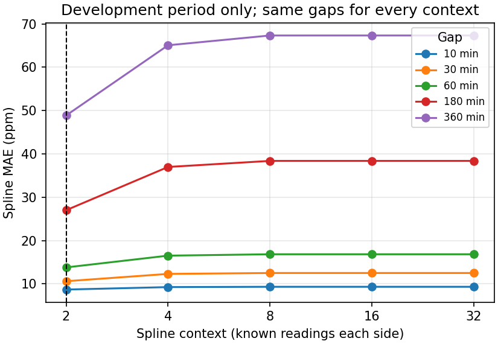
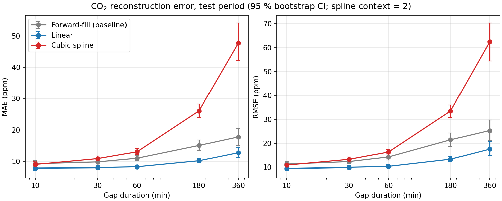

# Reconstructing Missing Indoor CO₂ Readings from a Building Sensor Log

*MMA3001 Numerical Methods and Machine Learning, individual project report. DRAFT for the author to review, edit and take ownership of.*

> **Note to author.** All numbers in this draft come from files produced by the code in this repository (`results/*.csv`, `results/*_run_info.json`, `data/processed/extraction_summary_6012002000869.json`). If you re-run anything, re-check the numbers. Sections marked **[AUTHOR]** need your own input.

## 1. Engineering problem

**Context.** Commercial buildings monitor indoor CO₂ because it is a practical proxy for how well a space is ventilated relative to the number of people in it. Building management (BMS) and HVAC analyses, such as ventilation audits, demand-controlled-ventilation tuning and comfort and energy reports, work on logged time series. Wireless sensor logs contain dropouts. Analyses then either discard incomplete periods or fill them, and filling them badly can bias averages, peak estimates and threshold-exceedance counts.

**Problem addressed.** Given a log of genuine CO₂ readings with a missing block, estimate the missing readings and quantify how the error of simple reconstruction methods grows with the length of the gap.

**Research question.** *How does the accuracy of reconstructing missing indoor CO₂ measurements degrade as gap duration increases, and how do linear interpolation and cubic-spline interpolation compare with a simple forward-fill baseline?* [AUTHOR: update the research question to include PCHIP]

**Intended use.** Retrospective gap filling of archived logs before analysis, with an evidence-based limit on how long a gap can be filled before the result should be flagged or discarded. Linear and spline interpolation use the reading *after* a gap, so they are not real-time methods. Only forward-fill could run in real time.

[AUTHOR: state that this follows Dataset 2's listed direction 'reconstructing missing sensor measurements']

[AUTHOR: one sentence on limits of scope: one sensor, retrospective use only]

## 2. Inputs, outputs and data

### 2.1 Inputs

| Input | Format | Units / domain | Handling of invalid input |
|---|---|---|---|
| Raw environmental CSV (`5EnvSensor_MayToDec2024_180kRows.csv`, 353 MB) | CSV with columns `id, sensorid, devicetype, jsondata, status, processing_errors, createdate, processdate` | `jsondata` is a JSON list of `{values:[{time, value}], variable:{name, unit}}` | Missing file → `FileNotFoundError`; missing column → `ValueError` |
| Sensor ID | string, exact match | `6012002000869` | No matching rows → the run stops with a message |
| CO₂ value | JSON number | ppm; accepted range 250–5000 ppm | Rejected and counted by reason: bad JSON, variable absent, wrong unit, empty values, `errorCode`, missing/non-numeric/NaN value, bad timestamp, out of range |

The JSON `time` is used rather than `createdate`. `createdate` is the server's storage time, it mixes +10 and +11 UTC offsets (daylight saving), and it keeps advancing while the sensor is silent.

Unsupported input: the interpolation methods refuse to extrapolate. A query time before the first or after the last known reading raises `ValueError`.

### 2.2 Outputs

| Output | Meaning and intended use |
|---|---|
| `data/processed/co2_6012002000869.csv` (`epoch_s, time_utc, co2_ppm`) | Cleaned series of genuine readings: the input to all experiments (kept local) |
| `results/co2_test_metrics.csv` | Per duration and method: number of gaps, hidden readings, boundary interval, bias, MAE and RMSE with 95 % CIs, midpoint error, 95th-percentile and maximum per-gap error, maximum overshoot, µs per gap, paired win fractions |
| `results/co2_dev_context_sensitivity.csv` | Development-period MAE and RMSE for each spline context size and method, all on one common gap set per duration (the tuning evidence) |
| `results/*_run_info.json`, `*_profile.txt`, `figures/*.png` | Run provenance (periods, seed, versions), cProfile output, figures |
| Function-level inputs/outputs | Each method returns an array of estimates at the query times, in the same units as the input. See the HTML API docs (`docs/api/`) |

### 2.3 Data audit findings

The environmental file has 179,447 rows from 5 sensors, but **only two sensors contain live data**. Sensors …227, …241 and …777 repeat one identical packet for every row. For the selected sensor `6012002000869`:

- Source rows: 29,341
- Genuine CO₂ readings: **13,800**
- Coverage: 90.8 % of the readings expected at a 600 s cadence

[AUTHOR: one sentence: the occupancy data were not used, and why]

## 3. Computational approach

### 3.1 Methods

Each method maps known readings `(t_known, y_known)` to estimates at hidden times `t_query`.

- **Forward-fill (baseline).** Repeats the last reading before the gap (a zero-order hold). It is causal and trivial, and it is what many logging systems do implicitly. Its error grows with how far the true signal drifts from the last value.
- **Linear interpolation.** The straight line between the readings either side of the gap (`numpy.interp`). For a smooth signal the error is O(h²·max|y″|). Because the estimate is a convex combination of the boundary values, it can never leave their range, so it cannot overshoot.
- **Cubic spline.** `scipy.interpolate.CubicSpline` with not-a-knot end conditions through the known context readings. It is C² continuous, and the error is O(h⁴·max|y⁗|) for smooth signals. Fitting solves one tridiagonal system, which is O(n). It has no shape constraint, so it can overshoot. Times are shifted to start at zero before fitting to keep the polynomial coefficients well scaled (raw Unix times are about 1.7 × 10⁹ s).
- **PCHIP.** [AUTHOR: write 2-3 sentences on PCHIP: what it is and why it was added]

**Why these methods.** They are the standard first-line numerical tools for filling missing values in a time series, they are fully interpretable, and they cost almost nothing on a CPU. The comparison tests a clear hypothesis: does the higher-order accuracy of the spline on smooth functions carry over to a real, noisy sensor signal?

**Assumptions.**
1. The JSON measurement time is correct.
2. The readings either side of a gap are genuine.
3. Readings are sampled finely enough that the signal between them is "smooth enough" (the spline assumes the most).
4. Artificial gaps placed at random behave like real dropouts.

### 3.2 Experimental design

- **Chronological split.** The first 70 % of readings form the development period: 9,660 readings, 29 Feb – 13 May 2024. The last 30 % form the test period: 4,140 readings, 14 May – 13 Jun 2024. No reading is in both, and gap contexts may not cross the boundary.
- **Gap duration.** The nominal duration D (10, 30, 60, 180 or 360 min) is the length of the time window, starting at a genuine reading, from which readings are removed. For example, a 10-minute gap always hides exactly one reading. In the test period its boundary readings were 20 min apart in 173 of 200 gaps, and 30 min apart in the 27 gaps next to a native missing reading.
- **Placement.** Up to 200 non-overlapping gaps per duration are placed at random with a fixed seed. Longer gaps could not always reach 200: the random non-overlapping placement achieved 187 three-hour and 92 six-hour test gaps.
- **Fairness and leakage.** All methods are scored on the same hidden readings and receive the same context: `context` known readings each side. The hidden indices are removed from the inputs, and an assertion in `reconstruct_gap` fails if any hidden reading reaches a method (tested in `tests/test_evaluation.py`).
- **Tuning.** The only tunable setting is the spline context (2, 4, 8, 16 or 32 known readings each side). It was chosen automatically on the development period by lowest mean spline MAE across durations.
- **Metrics.**
  - MAE and RMSE in ppm, pooled over all hidden readings, with 95 % percentile-bootstrap CIs (1,000 resamples of whole gaps, because readings within a gap are correlated);
  - maximum overshoot beyond the range of the context values;
  - % of gaps won: the share of gaps in which one method has a lower error than another, compared gap by gap.

### 3.3 Implementation

The Python package `src/gap_reconstruction/` contains `loader`, `extract`, `methods`, `evaluation`, `experiment` and `benchmark`. Supporting tooling:
- NumPy-style docstrings, with HTML docs generated by pdoc;
- a pytest suite (113 tests);
- pinned dependencies (numpy 1.26.4, scipy 1.13.1, matplotlib 3.9.2).

The 353 MB CSV is streamed once (about 5 s) by filtering on the `sensorid` string before any JSON is parsed. All experiments then read the 0.5 MB processed file. The complete experiment takes about 40 s on a laptop CPU.

## 4. Verification

- **Exactness against analytic answers.** Linear interpolation reproduces a straight line to 1e-9, and the not-a-knot spline reproduces a cubic polynomial to 1e-8, at realistic Unix-time magnitudes.
- **Convergence order.** Interpolating sin(x) on grids that are successively halved, the observed order for linear interpolation is 2 ± 0.2, and for the spline it is > 3.5 (theoretical 4).
- **Leakage guard.** A "poisoned" hidden value of 10⁶ never reaches the method, and the leak assertion fires on a deliberately broken gap.
- **PCHIP stays within the boundary readings.** On 300 noisy synthetic gaps, PCHIP never leaves the range of the two readings either side of the gap, while the spline does overshoot on the same data.
- **Test suite.** All 113 tests pass (pytest, latest run). [PENDING: regenerate `results/test-report.txt`, which still shows an older count]

## 5. Validation and results

**What was validated.** How accurately each method reproduces *genuine* CO₂ readings that were hidden on purpose. The true values are known, so this is ground-truth validation on withheld data from a later, untouched period.

**Why it is appropriate.** It measures exactly the intended use (filling holes in a real log), on the real noise and dynamics of this sensor, without using any hidden value as input.

**Did validation influence model selection?** Only the development period was used to choose the spline context. During development the test-period script was re-run several times after reporting-only changes (plot layout, an added bias column, the timing method). The method settings were never changed in response to test results, and the error metrics were identical on every rerun.

**Context tuning.** Context 2 had the lowest mean spline MAE and was selected. It is the smallest context the method allows: 2 readings each side give 4 points, so the not-a-knot spline is the single cubic through them. More context makes the spline *worse* (21.8 → 28.9 ppm).

*Figure 1. Spline MAE against context size, development period only, using the same 200 gaps per duration for every context. The dashed line marks the chosen value.*

**Table 1. Test-period CO₂ results** (`results/co2_test_metrics.csv`; spline context = 2). MAE in ppm, with the 95 % bootstrap interval over gaps in brackets. "Boundary interval" is the mean time between the known readings either side of a gap. Forward-fill and linear never overshoot, and PCHIP did not either (max overshoot 0.0 ppm at every duration).

| Gap D | Gaps | Boundary interval (min) | Forward-fill MAE | Linear MAE | Spline MAE | PCHIP MAE | Max overshoot, spline (ppm) |
|---|---|---|---|---|---|---|---|
| 10 min | 200 | 21.4 | 9.21 [8.31, 10.17] | **7.82** [7.08, 8.62] | 8.97 [8.12, 9.88] | 8.08 [7.32, 8.93] | 6.5 |
| 30 min | 200 | 41.3 | 9.78 [9.05, 10.53] | **7.98** [7.46, 8.52] | 10.83 [10.05, 11.64] | 8.38 [7.82, 8.96] | 17.1 |
| 1 h | 200 | 71.1 | 10.95 [10.12, 11.78] | **8.23** [7.73, 8.72] | 13.01 [12.09, 13.99] | 8.74 [8.19, 9.27] | 27.1 |
| 3 h | 187 | 191.8 | 15.05 [13.43, 16.80] | **10.15** [9.51, 10.84] | 26.13 [23.92, 28.36] | 11.11 [10.35, 11.94] | 81.9 |
| 6 h | 92 | 370.9 | 17.78 [15.07, 20.58] | **12.71** [11.20, 14.49] | 47.76 [42.28, 54.12] | 13.34 [11.61, 15.27] | 179.9 |

[AUTHOR: one sentence: % of gaps where linear beat each other method, from frac_gaps_* columns]

*Figure 2. Test-period MAE and RMSE against gap duration (log axis), with 95 % bootstrap CIs.*

**Signal context (test period).** CO₂ averaged 470 ppm (SD 39 ppm, 5th–95th percentile 428–555 ppm, maximum 634 ppm). The typical change between consecutive 10-minute readings was 9.0 ppm (mean absolute value), with 1 ppm resolution. This sets a noise floor: the 10-minute linear MAE (7.8 ppm) is already below the typical change between consecutive readings, so a single missing reading cannot be estimated much better from its neighbours.

[AUTHOR: acceptance criterion: MAE below the typical reading-to-reading change (9.0 ppm, from co2_run_info.json); state which methods/durations pass] Sensor-accuracy comparison: [AUTHOR: add only if a real sensor-accuracy source is found]

Unsupported inputs and failure modes: extrapolation refused; gaps > 6 h untested; spline overshoot.

**What the validation cannot establish.**
- Performance in rooms with high or fast-changing CO₂: this room never exceeded 634 ppm.
- Performance in other seasons, sensors or buildings.
- Performance on real dropouts if they are not random in time. Outages correlated with events, such as power or network failures, could behave differently.
- Whether the JSON timestamps are themselves correct.

## 6. Comparison and performance

**Accuracy.** Linear interpolation is the most accurate method at every duration tested.

How each method's MAE grows from 10 minutes to 6 hours:

| Method | MAE at 10 min | MAE at 6 h | Change |
|---|---|---|---|
| Linear | 7.8 ppm | 12.7 ppm | ×1.6 |
| PCHIP | 8.1 ppm | 13.3 ppm | ×1.7 |
| Forward-fill | 9.2 ppm | 17.8 ppm | ×1.9 |
| Cubic spline | 9.0 ppm | 47.8 ppm | ×5.3 |

The spline is worse than the forward-fill baseline from 30 minutes upward.

**Trade-offs.**

| Method | MAE at 1 h (ppm) | MAE at 6 h (ppm) | Max overshoot (ppm) | Runtime ratio vs linear | Real-time capable? | Complexity |
|---|---|---|---|---|---|---|
| Forward-fill | 10.95 | 17.78 | 0.0 | [PENDING: benchmark rerun] | [AUTHOR] | [AUTHOR] |
| Linear | 8.23 | 12.71 | 0.0 | 1 | [AUTHOR] | [AUTHOR] |
| Cubic spline | 13.01 | 47.76 | 179.9 | [PENDING: benchmark rerun] | [AUTHOR] | [AUTHOR] |
| PCHIP | 8.74 | 13.34 | 0.0 | [PENDING: benchmark rerun] | [AUTHOR] | [AUTHOR] |

**Runtime.** [PENDING: benchmark rerun]

**Profiling and FLOP estimate.**
- **Profile** (`results/co2_profile.txt`): for the spline, most of the time is spent constructing the `CubicSpline` object (`__init__` and `prepare_input` input checking), not doing arithmetic. Our own input validation is the next largest cost for all methods.
- **Arithmetic per gap** (context = 2 means 4 known points, with k ≤ 36 queries):
  - linear: about 5 FLOPs per query, under 200 FLOPs per gap;
  - spline: about 10n FLOPs to build the coefficients and solve the tridiagonal system with n = 4 (around 40), plus about 8 per query, under 400 FLOPs per gap.
- **Implication:** at about 500 µs per gap the spline achieves under 1 MFLOP/s, at least four orders of magnitude below a laptop core's peak (about 10¹⁰ FLOP/s). The computation is entirely limited by Python and library call overhead, so arithmetic intensity is irrelevant at this scale. [PENDING: benchmark rerun – update the µs figure]
- [AUTHOR: one sentence linking FLOP estimate to the Roofline model (Week 1)]
- [AUTHOR: memory use: negligible, 4 known points per gap]
- **Engineering implication:** filling all 1,390 native gaps in the 3.5-month log takes under a second with any method. Computational cost does not distinguish between the methods, so the choice should be made on accuracy and robustness. [PENDING: benchmark rerun – confirm the "under a second" estimate]

**Final design decision.** For retrospective gap filling of this sensor's CO₂ log, use **linear interpolation**. Flag reconstructed values, and treat gaps longer than an agreed limit (e.g. 6 h, the longest tested) as unfilled. Do not use an unconstrained cubic spline on noisy 10-minute CO₂ data.

## 7. Limitations and lessons learned

**Why the spline fails here.** The spline's O(h⁴) advantage assumes the signal is smooth at the sampling scale. At 10-minute sampling, this CO₂ signal varies by about 9 ppm between consecutive readings, either measurement noise or genuinely fast fluctuation, while longer-term trends are small. The spline treats the noisy boundary readings as if they defined a true slope and curvature. It continues that curvature across the gap, so overshoot rises from 6.5 ppm at 10 min to 180 ppm at 6 h. Linear interpolation cannot leave the range of its two boundary values, which makes it robust. [AUTHOR: one sentence on temperature: smoother signal, PCHIP slightly better at 3-6 h, consistent with explanation]

**Why long gaps are harder.** All methods only see the edges of a gap. Real changes inside it, such as occupancy events, ventilation cycles or day–night patterns, are invisible to them. The boundary readings are also single noisy samples, so any trend inferred from them is uncertain. As the gap gets longer, the true signal has more time to depart from what the boundaries suggest.

**Data-quality lesson.** Most rows in the raw file were stale copies, and three sensors had no live data at all. Without stale-reading detection, a naive analysis would have treated constant repeated values as real measurements and judged reconstruction on fake data.

**Limitations.**
- One sensor in one low-occupancy room (a storage mezzanine).
- 3.5 months of data, with a one-month test period in late autumn 2024.
- Artificial gaps placed at random.
- The device accuracy specification is unknown.
- The room location comes from a workbook that was not independently verified.

**Possible improvements (not implemented).**
- A smoothing spline or local regression to suppress noise before interpolating.
- A daily-profile or seasonal component for long gaps.
- Multivariate reconstruction using humidity or temperature.
- Validating on further sensors if the teaching team can supply repaired data.

**[AUTHOR] Personal lessons learned.** Add your own reflections here: what you learned and what surprised you. These must be your own.

## 8. AI-use reflection

[AUTHOR: ~350-word AI reflection covering the brief's 8 points: tools, uses, contribution level, why, how checked, decisions kept, errors, effect on learning]

## References

- Monash Smart Infrastructure, *MMA3001 Dataset – MSI Occupancy and Environmental* (provided by the MMA3001 teaching team, 2026).
- Virtanen, P. et al. (2020). SciPy 1.0: fundamental algorithms for scientific computing in Python. *Nature Methods* 17, 261–272.
- Harris, C. R. et al. (2020). Array programming with NumPy. *Nature* 585, 357–362.
- de Boor, C. (2001). *A Practical Guide to Splines* (rev. ed.). Springer. (Not-a-knot spline conditions and error bounds.)
- Burden, R. L. & Faires, J. D. *Numerical Analysis*. Cengage. (Interpolation error O(h²) and O(h⁴).)
- Efron, B. & Tibshirani, R. J. (1993). *An Introduction to the Bootstrap*. Chapman & Hall.
- [AUTHOR: add Fritsch, F. N. & Carlson, R. E. (1980), Monotone piecewise cubic interpolation, SIAM J. Numer. Anal. 17(2), 238–246, if PCHIP is cited; check this reference first]
- [AUTHOR: add a source for typical NDIR CO₂ sensor accuracy, and ventilation guidance such as ASHRAE 62.1 or the NCC/AS 1668.2, before relying on any sensor-accuracy comparison in Section 5.]
